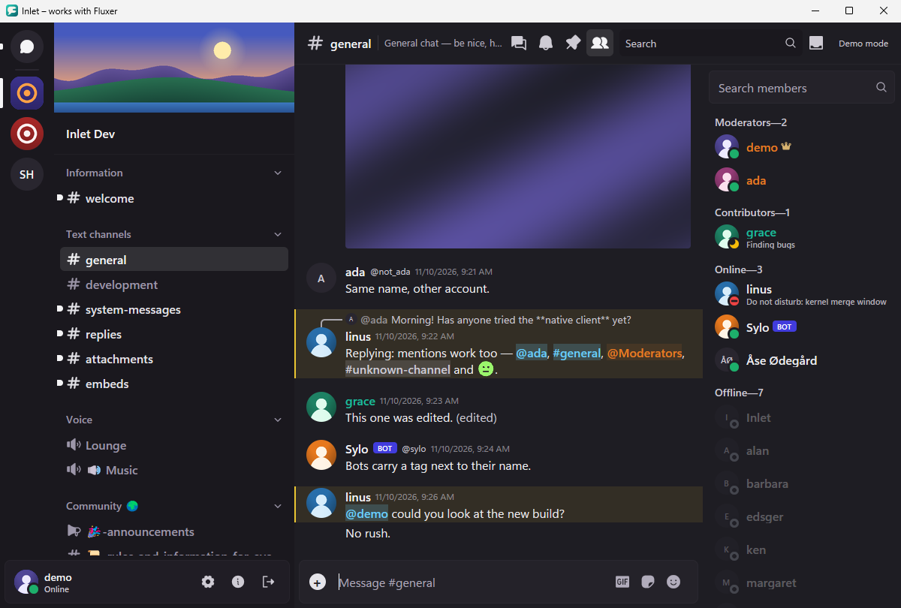

<p align="center">
  <picture>
    <source media="(prefers-color-scheme: dark)" srcset="assets/brand/inlet-lockup-dark.svg">
    
  </picture>
</p>

# Inlet

Inlet is a native desktop client for [Fluxer](https://github.com/fluxerapp/fluxer), the open-source, Discord-like chat platform. It is written in Rust with [gpui](https://www.gpui.rs/), the UI framework behind the Zed editor.

Fluxer's official desktop app is built on Electron. Inlet is a separate, native take on the same service. It aims for low memory use, fast start-up and stability, without a bundled web browser. There are no measurements in this repository yet, so treat those aims as goals, not results.

> **Status: early beta.** There is no stable release yet, and many features of the Fluxer web app are missing (see below). No pre-release build has been published so far. When one is, it will appear under [Releases](https://github.com/Ferdinand99/Inlet/releases) and will be marked as a pre-release. There is no date for it.
>
> Until the first release, development happens on the [`v0` branch](https://github.com/Ferdinand99/Inlet/tree/v0), which is the default branch for now. The `main` branch holds the release workflows and the macOS packaging, and becomes the default again at the first release.



*The Windows build with its built-in demo data. The names and messages in the picture are made up.*

## Features

### Working now

These are on the `v0` branch and wired up in the app. Some are merged but not yet in a release; no release exists yet, so they are listed here anyway.

- Sign in to a Fluxer instance by its address, either through your browser (you confirm a short code on the instance's own page) or by pasting an existing token. Inlet shows which account you signed in as before it saves anything.
- Stay signed in between starts. If the network is down at start-up or drops later, Inlet keeps retrying with growing delays, and offers a "Reconnect" button when it stops trying.
- Sign out. A token that Inlet got through the browser is also ended on the server. A token you pasted is only forgotten locally, because it belongs to another client.
- A server list, a channel list grouped by category, and the list of direct messages.
- Read the latest 50 messages of a channel. New, edited and deleted messages show up live. Messages show date separators, reply lines, a bot tag and an "(edited)" mark, and are highlighted when they mention you.
- Message text drawn with Fluxer's own markdown parser: bold, italic, underline, strikethrough, inline code, code blocks, quotes, lists, headings, spoilers (click to reveal), and mentions of users, roles and channels.
- Link safety: a link whose visible text hides its address shows the real host and asks you to confirm before it opens.
- Embeds (the cards that bots post) with colour bar, author, title, description, fields and footer.
- Send text messages.

### In progress and planned

None of this works in the app yet. Some of it exists as library code in the workspace but is not connected to the app.

- Images, avatars, attachments and custom emoji. For now attachments show as links and avatars as initials.
- A fuller composer: mentions, emoji, GIF and sticker pickers, file uploads.
- Reactions, replying, editing and deleting messages, typing indicators and presence.
- Loading older messages by scrolling back.
- Pinned and saved messages, the inbox of mentions, and jumping to a message.
- Threads, forums and media channels.
- Unread markers, muting and notification levels.
- Desktop notifications, sounds, badges and a tray icon.
- Search and a quick switcher.
- Member list, profiles, friends and group DMs.
- Several accounts signed in at the same time. Today Inlet runs one session at a time.
- A settings screen and keyboard shortcuts.
- Voice calls first, then video and screen sharing.

## Platforms

| Platform | Notes |
|---|---|
| Windows | x86_64 |
| macOS | Apple silicon, macOS 12 or later. Release builds are signed with a Developer ID and notarised by Apple. |
| Linux | x86_64. Needs a graphics driver with Vulkan support. |

## Install

There is nothing to download yet, because no release has been published. Once there is one, get the file for your system from [Releases](https://github.com/Ferdinand99/Inlet/releases):

- Windows: `inlet-windows-x86_64.exe`. The file is not code-signed, so Windows SmartScreen may warn you. Choose "More info", then "Run anyway".
- macOS: `inlet-macos-aarch64.dmg`. Open it and drag Inlet to Applications.
- Linux: `inlet-linux-x86_64.tar.gz`.

Every release has a `SHA256SUMS.txt` file. Check your download against it before you run it.

## Using Inlet

Start Inlet, type the address of a Fluxer instance and sign in. Any instance works: the official one, or one you host yourself, such as `fluxer.opland.net`. Inlet looks up the instance's API and gateway addresses from the address you give it and talks only to that instance's own servers.

Signing in to several accounts at once is planned but not available yet.

**Where your token lives.** The session token is stored in your system's credential store: macOS Keychain, Windows Credential Manager, or the Secret Service on Linux (for example GNOME Keyring or KWallet). It is never written to a file and never logged. Two small files in your config folder are not secret: the address of the last instance you used, and a random installation ID that the instance shows in your list of sessions.

**Telemetry.** There is none. Inlet has no analytics, no crash reporting and no update check.

## Building from source

The code is on the `v0` branch (`git clone --branch v0 https://github.com/Ferdinand99/Inlet`). The Rust toolchain is pinned in [`rust-toolchain.toml`](https://github.com/Ferdinand99/Inlet/blob/v0/rust-toolchain.toml); `rustup` installs it on the first build. You also need the system libraries that gpui uses:

- **Windows:** the MSVC build tools (Visual Studio Build Tools with the C++ workload).
- **macOS:** Xcode, including the Metal toolchain (`xcodebuild -downloadComponent MetalToolchain` if it is missing).
- **Linux (Debian and Ubuntu package names):** `build-essential cmake clang lld pkg-config libasound2-dev libfontconfig-dev libglib2.0-dev libssl-dev libvulkan1 libvulkan-dev libwayland-dev libx11-xcb-dev libxcb1-dev libxkbcommon-dev libxkbcommon-x11-dev libzstd-dev`

```sh
cargo build --release -p inlet
```

The binary is `target/release/inlet` (`inlet.exe` on Windows). On Linux the notification sound uses ALSA's `libasound.so.2` (package `libasound2`), loaded only when a sound plays: without it Inlet runs normally, without the sound. [`docs/BUILDING.md`](https://github.com/Ferdinand99/Inlet/blob/v0/docs/BUILDING.md) describes a reproducible Docker-based build for builds, tests and checks on Linux.

## Workspace layout

- [`crates/inlet-app`](https://github.com/Ferdinand99/Inlet/tree/v0/crates/inlet-app): the `inlet` application: window, views and backend.
- [`crates/inlet-protocol`](https://github.com/Ferdinand99/Inlet/tree/v0/crates/inlet-protocol): talks to a Fluxer instance: discovery, sign-in, REST and gateway.
- [`crates/inlet-state`](https://github.com/Ferdinand99/Inlet/tree/v0/crates/inlet-state): per-account client state: guilds, channels, members, permissions, read state and message windows.
- [`crates/inlet-media`](https://github.com/Ferdinand99/Inlet/tree/v0/crates/inlet-media): fetches, decodes, caches and animates images, with hard limits on untrusted input.
- [`crates/inlet-editor`](https://github.com/Ferdinand99/Inlet/tree/v0/crates/inlet-editor): the message composer's text model and gpui element.
- [`crates/inlet-emoji`](https://github.com/Ferdinand99/Inlet/tree/v0/crates/inlet-emoji): Fluxer's emoji shortcodes and categories, search, skin tones and Twemoji graphics.

## Contributing and reporting bugs

Issues are welcome: bug reports, missing features and questions. Please say which operating system you use, which Inlet version or commit, and what you expected to happen. Do not post tokens or private messages.

If you find a security problem, please do not open a public issue. Contact the maintainer privately through GitHub instead, and give the details there.

## Licence

Inlet is licensed under the [GNU Affero General Public License, version 3 or later](LICENSE) (AGPL-3.0-or-later). The licences of the third-party code it uses are listed in [THIRD-PARTY-NOTICES](https://github.com/Ferdinand99/Inlet/blob/v0/THIRD-PARTY-NOTICES).

Inlet is an independent project and is not made or endorsed by Fluxer Platform AB. "Fluxer" is their trademark.
